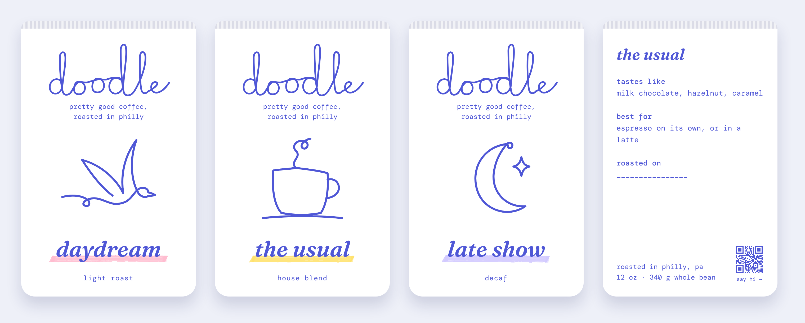
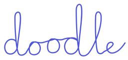

# doodle — brand guidelines

**pretty good coffee, roasted in philly.** Specialty coffee without the snobbery, drawn by hand. See `DESIGN_BRIEF.md` for who it's for and why.

## Voice

Plain, warm, a little wry. Undersell on purpose and let the coffee prove it.

- Lowercase everywhere: the wordmark, roast names, labels, buttons, taglines. Long-form sentences may use normal capitals.
- Tasting notes in everyday words: "milk chocolate, hazelnut, caramel," not "notes of dark cocoa."
- Roast names are moments, not origins: *daydream*, *the usual*, *late show*. In running text, set them in the italic serif: "try *the usual* with oat milk."
- Short sentences. No exclamation marks, no coffee jargon, no emoji.

## Logo

One continuous pen line: lowercase "doodle," every letter connected, with a gentle bounce and a tall second d.

- Use the file as drawn: `assets/logo/doodle-wordmark-periwinkle.svg`. Never retype "doodle" in a font as the logo, and never add underlines, sparkles, outlines or effects.
- One ink: periwinkle on white. White version (`doodle-wordmark-white.svg`) only on photos or periwinkle.
- Clear space: the height of its o's on every side. Minimum width: 80px on screen, 25mm in print. Smaller than that, use the symbol.
- Symbol: the hero "d" (`doodle-symbol-periwinkle.svg`; `doodle-symbol-small-periwinkle.svg` below 32px).
- App icon and favicon: white "d" on a periwinkle tile (`assets/icons/`). Alternate: periwinkle "d" on lilac.

## Color

White and one ink. Pastels appear only as highlighter strokes.

| Token | Hex | Use |
| --- | --- | --- |
| `paper` | #FFFFFF | Bags, cups, page background |
| `mist` | #EEF0F8 | Quiet section backgrounds on the web |
| `periwinkle` | #4F57D6 | The one ink: logo, drawings, all text (5.8:1 on white) |
| `navy` | #1E2366 | Text on mist or pastel when more contrast is needed |
| `blush` | #FFB8CD | *daydream* highlighter |
| `butter` | #FFE066 | *the usual* highlighter |
| `lilac` | #CFC6FF | *late show* highlighter |

Never: text set on pastel, pill shapes, gradients, color blocks, drop shadows on brand marks, or any red/tomato from early explorations.

## Type

| Role | Font | Settings |
| --- | --- | --- |
| Roast names, headlines | **Fraunces** italic (Google Fonts) | weight 600, `font-variation-settings: "SOFT" 100, "WONK" 1, "opsz" 144`, lowercase |
| Everything else | **DM Mono** (Google Fonts) | weight 400, 500 for small labels |

Google Fonts URL: `https://fonts.googleapis.com/css2?family=Fraunces:ital,opsz,wght,SOFT,WONK@1,9..144,400..700,0..100,0..1&family=DM+Mono:wght@400;500&display=swap`

No handwriting-style fonts: the logo and drawings are the only handwriting.

## Highlighter underline

One pastel chisel-tip highlighter stroke sits just under a roast name (or one key word in a web headline), catching only the bottoms of the letters and overhanging each side by about 16px. Even width, angled ends, slightly fuzzy edges. One per name, never behind other text, never two on one line. Files: `assets/highlighters/`.

## Drawings

Single periwinkle lines (one or two strokes) with small loops, same weight as the logo. No fills, shading, or colored circles behind them. Files: `assets/drawings/` — *daydream* bird, *the usual* mug, *late show* moon; a sleepy fish and a sleeping cat are spares.

## Packaging

- **Front (five things):** wordmark; "pretty good coffee, / roasted in philly" on two lines; the drawing; the roast name with its highlighter; the roast level.
- **Back label:** roast name, tastes like, best for, roasted on (handwritten date), "roasted in philly, pa", weight (12 oz · 340 g whole bean), and a QR code bottom-right with "say hi →".
- QR at least 2cm (¾") square with a white margin. It points to one page: reorder, the brew guide for that roast, and the cart schedule.

## Web

- White page, periwinkle text, generous space. `mist` for alternating sections.
- Headlines in Fraunces italic, lowercase; one highlighter under the key word of the hero headline only.
- Body, navigation, buttons, prices and forms in DM Mono, lowercase.
- Primary button: periwinkle fill, white DM Mono text, 10px corners, at least 44px tall. Secondary: periwinkle text with a highlighter underline on hover.
- Use the drawings as illustrations at generous size; never put them in colored circles.
- Product photos: bags on real counters in daylight, never on colored backdrops.

## The cart and cups

White cart, large periwinkle wordmark on the front, the three drawings along the side, the three bags on the counter priced and in reach. Cups are white with the periwinkle wordmark and a small blank box to doodle in.

## Before print

The logo, drawings and highlighters were drawn in code. Have an illustrator redraw them by hand, scan the highlighter strokes at 600 dpi, and clear the "doodle" trademark first.
